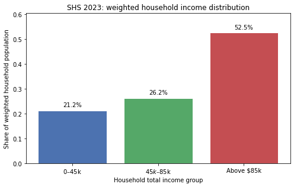
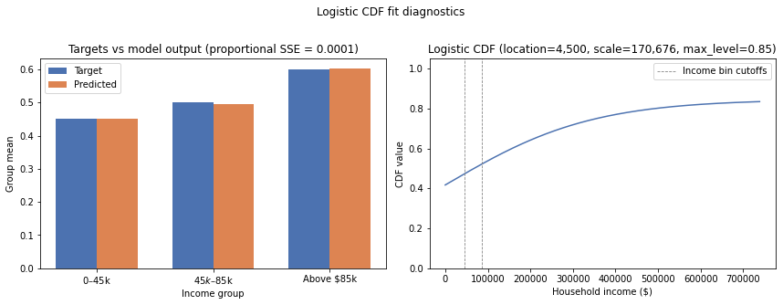
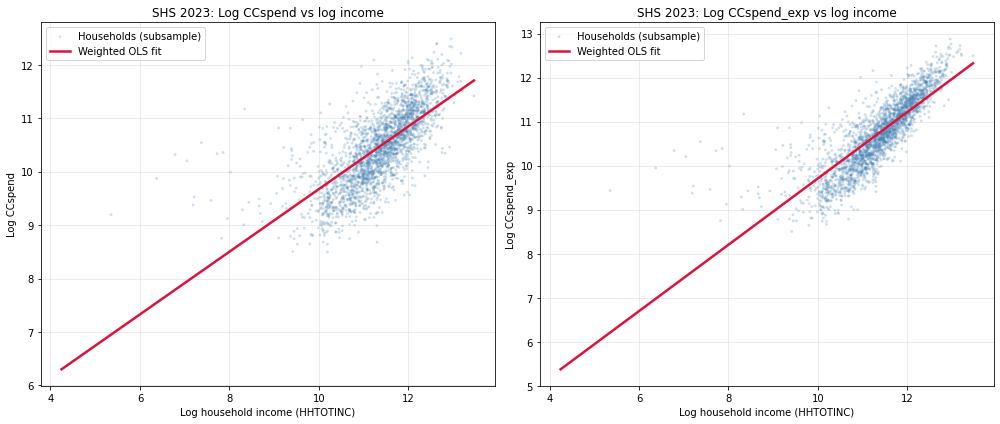
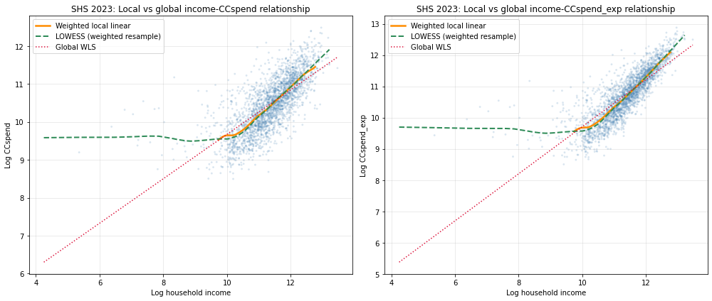
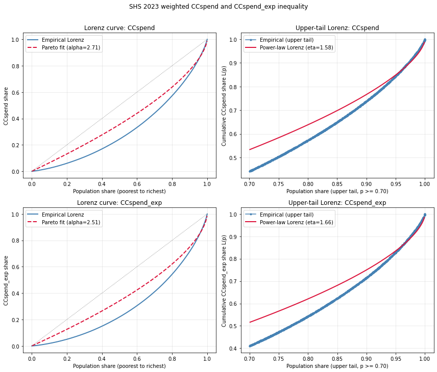
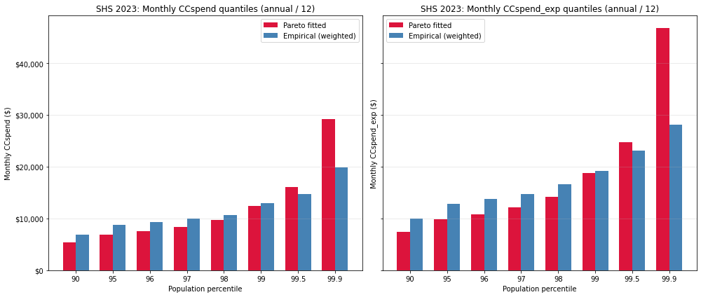
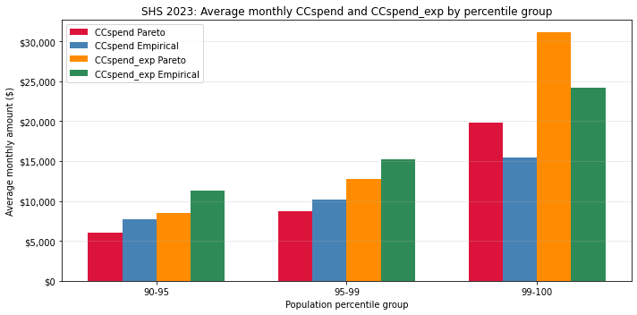

# Imputed credit-card spend from SHS 2023 household income

**Summary of findings from `logistic_cc_fit.ipynb`** — Statistics Canada Survey of Household Spending (SHS) 2023 PUMF, 5,485 households, all statistics weighted by survey weights.

## What the notebook does

The SHS reports household income and total consumption/expenditure, but not what share of spending goes on a credit card. The notebook imputes that share by:

1. Fitting a **logistic CDF of income** so that the model's average credit-card share in three income bands matches external targets (45%, 50%, 60% for the bands below).
2. Applying the fitted curve to every household to get `imputed_CC_prop`, and multiplying it into total consumption (`CCspend`) and total expenditure (`CCspend_exp`).
3. Analysing the resulting spend distributions: income elasticity, inequality (Lorenz/Pareto), and the size of the upper tail.

## The sample

Weighted household counts by total-income band:

| Income group | Share of households |
|---|---|
| $0–$45k | 21.2% |
| $45k–$85k | 26.2% |
| Above $85k | 52.5% |

## 1. Fitted credit-card share curve

The optimiser (scaled parameters, proportional SSE) reproduces the three group targets almost exactly (SSE ≈ 0.0001):

| Parameter | Value |
|---|---|
| Location | $4,500 |
| Scale | $170,676 |
| Max level (asymptote) | 0.846 |

The curve starts around a 42% credit-card share at very low incomes and rises smoothly toward a ceiling of ~85% at very high incomes. Weighted group means come out at 45.2% / 49.6% / 60.2%, matching the 45% / 50% / 60% targets.

## 2. Credit-card spend rises less than proportionally with income

Weighted OLS of log spend on log income:

| Measure | Slope (elasticity) | R² |
|---|---|---|
| `CCspend` (consumption-based) | **0.59** | 0.51 |
| `CCspend_exp` (expenditure-based) | **0.75** | 0.67 |

Both elasticities are well below 1: a 10% higher income is associated with roughly 6–7.5% higher credit-card spend. The expenditure-based measure tracks income more tightly because total expenditure includes items (taxes, mortgage principal, etc.) that scale more directly with income.

Local (LOWESS / local-linear) regressions show the relationship is not globally log-linear: below roughly $22k of income (log income ≈ 10), spend is essentially **flat** — low-income households spend a floor amount regardless of income — while above that the local slope is steeper than the global OLS line. The single-elasticity summary is therefore best read as an average over a kinked relationship.

## 3. Inequality and the upper tail

Credit-card spend is concentrated, but less extremely than income or wealth typically are:

| Statistic | CCspend | CCspend_exp |
|---|---|---|
| Top 10% share | 26.3% | 28.5% |
| Top 5% share | 15.7% | 17.1% |
| Top 1% share | 4.4% | 4.9% |
| Pareto alpha | 2.71 | 2.51 |

A Pareto alpha of 2.5–2.7 is a fairly "thin" heavy tail (for comparison, wealth distributions are often near 1.5). The Lorenz curves confirm this: the Pareto fit tracks the empirical curve well in the far upper tail (roughly the top 5%) but overstates concentration in the middle of the distribution.

## 4. How much do top spenders put on cards per month?

Monthly figures are annual spend divided by 12. Empirical weighted quantiles vs the fitted Pareto model:

| Percentile | CCspend empirical | CCspend Pareto | CCspend_exp empirical |
|---|---|---|---|
| 90th | $6,857 | $5,343 | $10,001 |
| 95th | $8,728 | $6,899 | $13,271 |
| 99th | $13,003 | $12,491 | $19,270 |
| 99.9th | $19,842 | $29,202 | $28,187 |

The Pareto model under-predicts quantiles between the 90th and ~99th percentile and over-predicts at the extreme (99.9th) — consistent with the empirical tail being slightly less heavy than a pure power law.

Average monthly spend by percentile group (empirical, weighted):

| Group | CCspend | CCspend_exp |
|---|---|---|
| 90–95th | $7,706 | $11,288 |
| 95–99th | $10,226 | $15,277 |
| Top 1% | $15,460 | $24,155 |

## Key takeaways

- The three-band calibration is easily satisfied: a logistic share curve rising from ~42% to an ~85% ceiling reproduces the 45/50/60% targets with negligible error.
- Imputed credit-card spend has an income elasticity of about **0.6 (consumption basis)** to **0.75 (expenditure basis)** — spend rises with income, but well less than one-for-one, and the relationship is flat below roughly $22k of income.
- The top 10% of card spenders account for a bit over a quarter of all card spend; the top 1% average roughly **$15k–$24k per month** depending on the spend definition.
- A Pareto tail with alpha ≈ 2.5–2.7 fits the far upper tail reasonably, but a pure power law is a poor description of the middle of the distribution and exaggerates the extreme (99.9th percentile) tail.

## Caveats

- `imputed_CC_prop` is a deterministic function of income; all within-income-band variation in card usage is assumed away, so the spend distributions inherit their shape from consumption/expenditure, not from card behaviour.
- Results depend on the three external share targets (45/50/60%) and on the choice of consumption (`TC001`) vs expenditure (`TE001`) as the base.
- Percentile figures at 99.5+ rest on few effective observations and should be treated as indicative.
